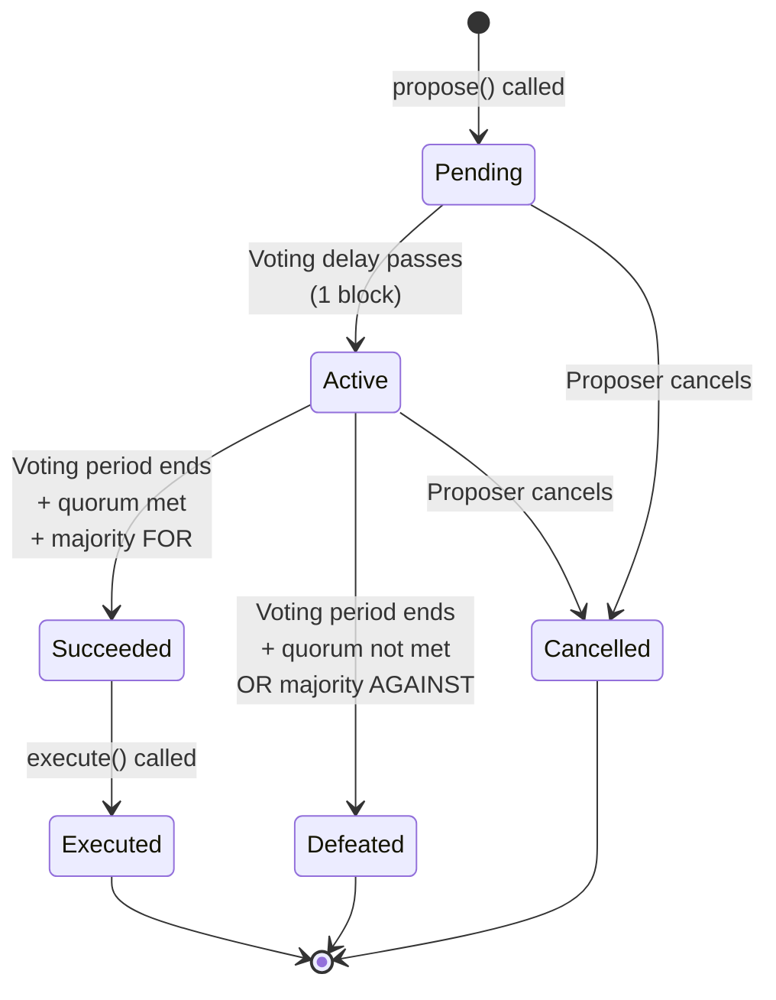

# Proposals

A governance proposal is a formal, on-chain request to make a change to the Vanguard protocol. This page covers how to create, structure, and submit proposals.

## Proposal Structure

Every proposal contains:

| Field | Type | Description |
|-------|------|-------------|
| `targets` | address[] | Contract addresses to call |
| `values` | uint256[] | ETH values to send (usually 0) |
| `calldatas` | bytes[] | Encoded function calls |
| `description` | string | Human-readable description |

A single proposal can contain multiple contract calls, allowing complex governance actions in one vote.

## Who Can Propose

You can submit a proposal if either condition is met:

1. **You hold Captain (CPT) rank** — regardless of VGRD balance
2. **You hold 100,000+ VGRD** — regardless of rank

```javascript
const dao = await ethers.getContractAt("VanguardDAO", addresses.VanguardDAO);

const threshold = await dao.proposalThreshold();
console.log("Threshold:", ethers.formatEther(threshold), "VGRD"); // 100,000.0
```

## Creating a Proposal

### Example: Change the PVT Reward Multiplier

Suppose the community wants to increase the Private multiplier from 1.0x (100) to 1.5x (150):

```javascript
const dao = await ethers.getContractAt("VanguardDAO", addresses.VanguardDAO);
const rankManager = await ethers.getContractAt("RankManager", addresses.RankManager);

// Encode the function call
const calldata = rankManager.interface.encodeFunctionData(
  "setMultiplier",
  [1, 150]  // rank 1 (PVT), new multiplier 150 (1.5x)
);

// Create the proposal
const tx = await dao.propose(
  [addresses.RankManager],  // targets
  [0],                       // values (no ETH)
  [calldata],                // calldatas
  "Increase PVT multiplier from 1.0x to 1.5x to improve new member retention"
);

const receipt = await tx.wait();
// The proposalId is emitted in the ProposalCreated event
```

### Multi-Action Proposals

A proposal can contain multiple actions. For example, a proposal that adjusts both multipliers and the voting period:

```javascript
const targets = [addresses.RankManager, addresses.RankManager, addresses.VanguardDAO];
const values = [0, 0, 0];
const calldatas = [
  rankManager.interface.encodeFunctionData("setMultiplier", [1, 150]),
  rankManager.interface.encodeFunctionData("setMultiplier", [2, 170]),
  dao.interface.encodeFunctionData("setVotingPeriod", [91636])  // ~2 weeks
];
const description = "Adjust enlisted multipliers and extend voting period to 2 weeks";

await dao.propose(targets, values, calldatas, description);
```

## Proposal Lifecycle



### State Definitions

| State | Description |
|-------|-------------|
| **Pending** | Proposal submitted, voting has not started yet (1 block delay) |
| **Active** | Voting is open for ~1 week (45,818 blocks) |
| **Succeeded** | Voting ended, quorum met, majority voted FOR |
| **Defeated** | Voting ended, quorum not met or majority voted AGAINST |
| **Executed** | Proposal actions have been executed on-chain |
| **Cancelled** | Proposer withdrew the proposal before execution |

### Checking Proposal State

```javascript
const state = await dao.state(proposalId);
// 0=Pending, 1=Active, 2=Cancelled, 3=Defeated, 4=Succeeded, 5=Queued, 6=Expired, 7=Executed
```
