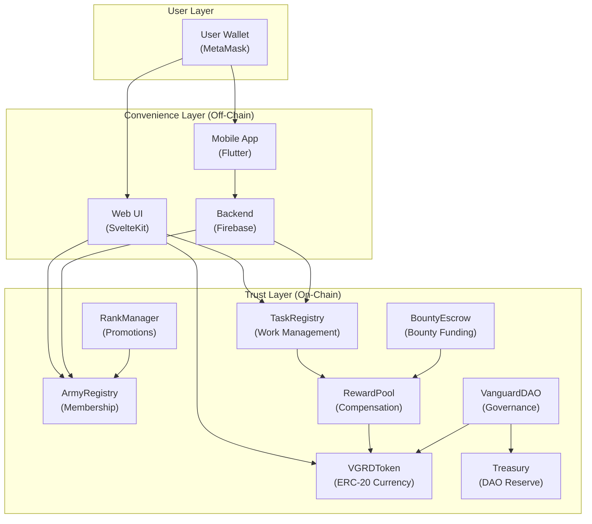
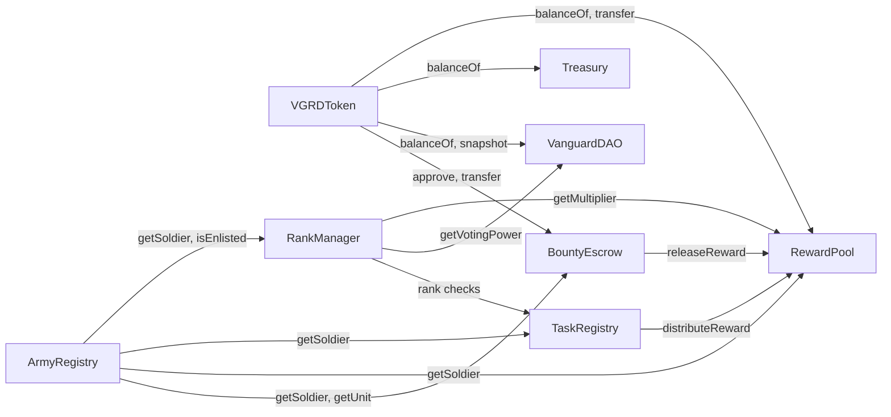
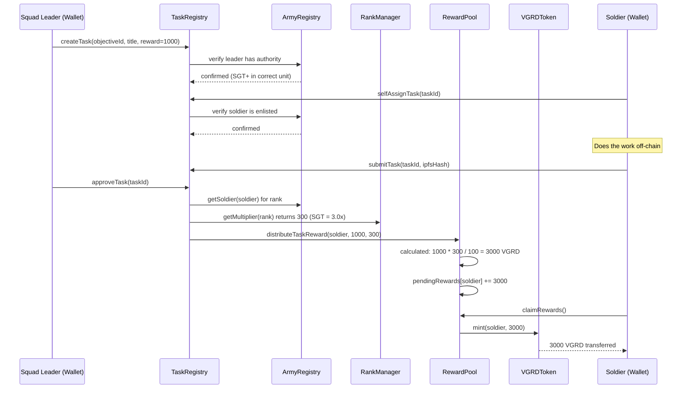

# Architecture at a Glance

## System Architecture

Vanguard is a multi-layer system. The smart contracts form the **trust layer** — the source of truth for membership, work records, token balances, and governance decisions. Everything else (the web UI, mobile app, backend services) is a **convenience layer** that reads from and writes to the contracts.

## Contract Dependency Graph

The eight contracts are connected through a specific dependency and permission structure. Understanding this graph is essential for developers and auditors.

## Role-Based Access Control

Every contract uses OpenZeppelin's `AccessControl` to restrict sensitive functions. Roles are granted during deployment and can be modified through governance.

| Role | Held By | Grants Permission To |
|------|---------|---------------------|
| `DEFAULT_ADMIN_ROLE` | Deployer wallet | Grant/revoke all other roles |
| `MINTER_ROLE` | RewardPool | Mint new VGRD tokens |
| `PAUSER_ROLE` | Deployer wallet | Pause/unpause token transfers |
| `RANK_MANAGER_ROLE` | RankManager contract | Update soldier ranks in ArmyRegistry |
| `DISTRIBUTOR_ROLE` | TaskRegistry | Trigger reward distribution in RewardPool |
| `ADMIN_ROLE` | TaskRegistry, Deployer | Administrative functions in ArmyRegistry |
| `DAO_ROLE` | Deployer (to be transferred to VanguardDAO) | Treasury withdrawals, parameter changes |
| `EXECUTOR_ROLE` | Deployer (to be transferred) | Execute passed governance proposals |

!!! warning "Future Feature"
    **Role Transfer to DAO:** Currently, the deployer wallet holds administrative roles. The roadmap includes transferring `DEFAULT_ADMIN_ROLE`, `DAO_ROLE`, and `EXECUTOR_ROLE` to the VanguardDAO contract, completing the transition to fully decentralized governance. This is a critical milestone for production readiness.

## Network and Infrastructure

| Property | Value |
|----------|-------|
| **Blockchain** | Base (Ethereum L2, built on OP Stack) |
| **Current Network** | Base Sepolia (Testnet), Chain ID `84532` |
| **Target Network** | Base Mainnet, Chain ID `8453` |
| **RPC Endpoint** | `https://sepolia.base.org` |
| **Block Explorer** | `https://sepolia.basescan.org` |
| **Solidity Version** | 0.8.20 |
| **Framework** | Hardhat with ethers.js v6 |
| **Token Standard** | ERC-20 (OpenZeppelin v5.4) |
| **Consensus** | Inherited from Ethereum via OP Stack |

**Why Base?** Base is an Ethereum L2 with low transaction costs (typically under $0.01 per transaction), fast confirmation times (2 seconds), and full EVM compatibility. This makes it practical for a protocol where participants submit multiple transactions per day (task assignments, submissions, approvals).

## Data Flow: A Task from Start to Finish

To ground the architecture in a concrete example, here is the complete data flow when a soldier completes a task:

This entire flow is enforced by smart contracts. No human intermediary can alter the reward calculation, skip the approval step, or redirect the tokens.
