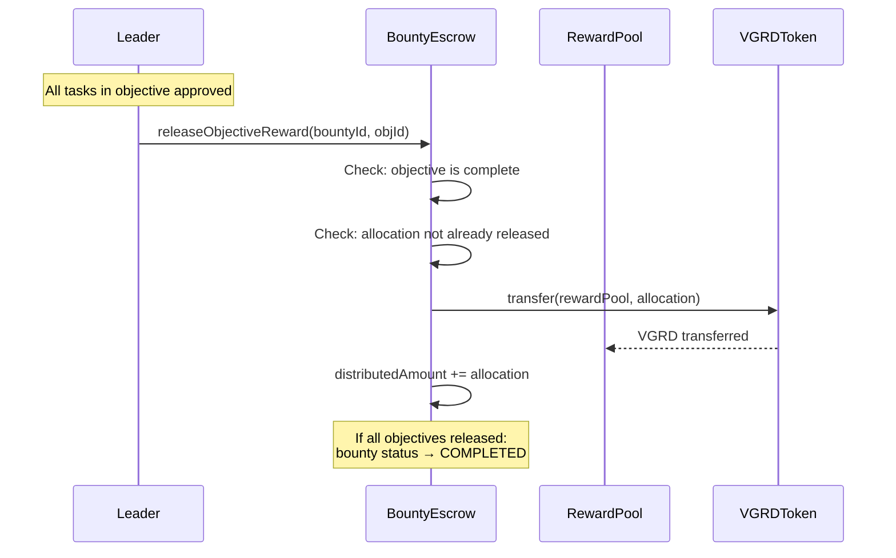

# Bounties

A bounty is a **funded project** in the Vanguard protocol. It represents a body of work with a defined VGRD budget, one or more objectives (deliverables), and a clear start-to-finish lifecycle.

## Bounty Structure

| Field | Type | Description |
|-------|------|-------------|
| `id` | uint256 | Auto-incrementing bounty identifier |
| `creator` | address | Wallet that created and funded the bounty |
| `totalAmount` | uint256 | Total VGRD deposited into escrow |
| `distributedAmount` | uint256 | VGRD released so far to RewardPool |
| `status` | enum | ACTIVE, COMPLETED, or CANCELLED |
| `objectiveAllocations` | mapping | VGRD allocated to each objective |

## Creating a Bounty

### Requirements

1. **Rank:** You must be Captain (CPT, rank 11) or higher
2. **VGRD balance:** You must hold enough VGRD to fund the bounty
3. **Approval:** You must approve the BountyEscrow contract to spend your VGRD before creating the bounty

### Process

**Step 1: Approve token spending**

```javascript
const token = await ethers.getContractAt("VGRDToken", addresses.VGRDToken);
const bountyAmount = ethers.parseEther("50000"); // 50,000 VGRD

// Allow BountyEscrow to transfer your tokens
await token.approve(addresses.BountyEscrow, bountyAmount);
```

**Step 2: Create the bounty**

```javascript
const escrow = await ethers.getContractAt("BountyEscrow", addresses.BountyEscrow);

// Create bounty with objective allocations
// objectiveIds and amounts must be arrays of equal length
const tx = await escrow.createBounty(
  bountyAmount,
  [objectiveId1, objectiveId2],    // which objectives this funds
  [ethers.parseEther("30000"), ethers.parseEther("20000")]  // allocation per objective
);
await tx.wait();
```

The sum of objective allocations must equal the total bounty amount. Upon creation, the VGRD tokens are transferred from your wallet to the BountyEscrow contract.

## Bounty Lifecycle

### ACTIVE

The bounty is funded and work is in progress. Objectives linked to this bounty are being worked on. As objectives complete, their allocated VGRD is released to the RewardPool.

### COMPLETED

All linked objectives are complete, and all funds have been distributed. The bounty is finalized and no further changes are possible.

### CANCELLED

The bounty creator (or DAO governance) has cancelled the bounty. Any undistributed VGRD is refunded to the creator. Objectives and tasks that were already completed retain their rewards — cancellation only affects unreleased funds.

## Fund Release Mechanism

When an objective linked to a bounty is fully completed:

1. `BountyEscrow.releaseObjectiveReward(bountyId, objectiveId)` is called
2. The escrow transfers the objective's VGRD allocation to the RewardPool
3. The RewardPool uses these funds to pay soldiers who completed the objective's tasks
4. The bounty's `distributedAmount` increases by the released amount



## Bounty Economics

### Who Funds Bounties?

Bounties are funded by individual Captains from their personal VGRD holdings. This means:

- A Captain must have earned or acquired VGRD before creating a bounty
- The Captain's personal balance decreases when the bounty is created
- The Captain is economically incentivized to create bounties for work that generates value (since their tokens are at stake)

### Bounty Size Guidelines

There are no minimum or maximum bounty sizes enforced by the contract. However, practical guidelines suggest:

| Bounty Size | Typical Use |
|------------|-------------|
| 1,000 - 10,000 VGRD | Small task collection (documentation, bug fixes) |
| 10,000 - 100,000 VGRD | Medium project (feature development, research) |
| 100,000 - 1,000,000 VGRD | Large initiative (product launch, partnership) |
| 1,000,000+ VGRD | Strategic program (multi-quarter effort) |

### Treasury-Funded Bounties

!!! warning "Future Feature"
    A mechanism for the Treasury to fund bounties directly (via governance proposal) is planned but not yet implemented. Currently, only individual Captains can create and fund bounties from their personal holdings.
