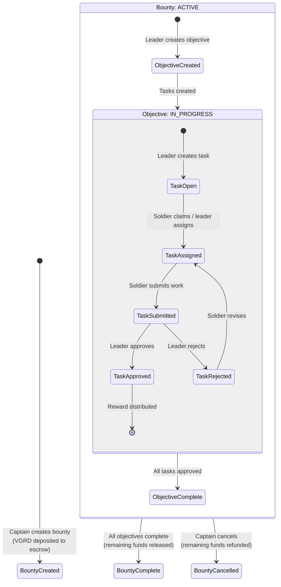

# Operations Overview

The operations layer is where work gets done in Vanguard. Three interconnected concepts form the work management hierarchy:

```
Bounty (funded project)
  └── Objective (workstream / milestone)
       └── Task (individual work item)
```

Think of it this way:

| Vanguard | Software Analogy | Business Analogy |
|----------|-----------------|-----------------|
| Bounty | Repository / Epic | Funded project or contract |
| Objective | Pull Request / User Story | Deliverable or milestone |
| Task | Commit / Issue | Individual work item |

## How They Relate

**A Bounty** is a funded initiative. A Captain deposits VGRD into escrow and defines what work needs to be done. A bounty contains one or more objectives.

**An Objective** is a workstream within a bounty. It groups related tasks and tracks their collective progress. When all tasks in an objective are approved, the objective is complete and its allocated bounty funds are released.

**A Task** is a single piece of work. It has a description, a VGRD reward, and a lifecycle (open → assigned → submitted → approved). Completing a task earns the soldier VGRD from the RewardPool.

## The Complete Lifecycle



## Who Does What

| Action | Required Rank | Contract |
|--------|--------------|----------|
| Create bounty | CPT (Captain) | BountyEscrow |
| Fund bounty | Any (must hold VGRD) | BountyEscrow |
| Create objective | SGT+ | TaskRegistry |
| Create task | SGT+ | TaskRegistry |
| Assign task | SGT+ | TaskRegistry |
| Self-assign task | Any enlisted | TaskRegistry |
| Submit task | Assigned soldier | TaskRegistry |
| Approve task | SGT+ (in same unit) | TaskRegistry |
| Reject task | SGT+ (in same unit) | TaskRegistry |
| Claim rewards | Any soldier with pending | RewardPool |

The following pages detail each concept in depth.
