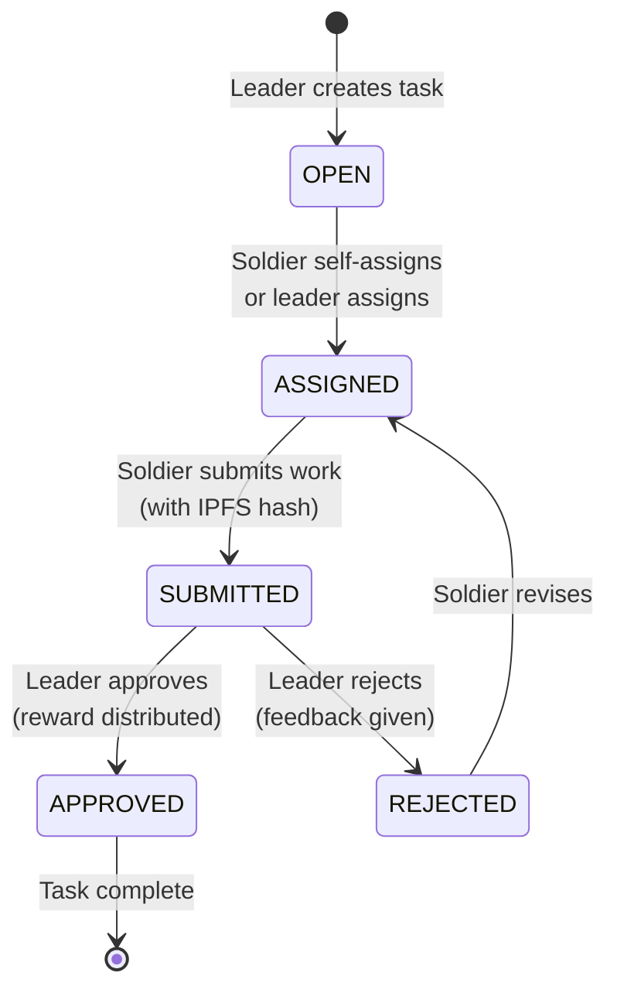

# Tasks

Tasks are the **atomic unit of work** in Vanguard. Every productive contribution to the DAO is represented as a task with a defined reward, lifecycle, and verifiable completion record.

## Task Structure

| Field | Type | Description |
|-------|------|-------------|
| `id` | uint256 | Auto-incrementing task identifier |
| `objectiveId` | uint256 | Parent objective |
| `creator` | address | Leader who created the task |
| `assignee` | address | Soldier assigned to complete it |
| `title` | string | Human-readable title |
| `description` | string | Detailed description and requirements |
| `rewardAmount` | uint256 | Base VGRD reward (before multiplier) |
| `status` | enum | OPEN, ASSIGNED, SUBMITTED, APPROVED, REJECTED |
| `submissionHash` | string | IPFS hash of submitted deliverable |

## Task Lifecycle



### State: OPEN

The task exists but no one is working on it. Any enlisted soldier can self-assign it, or a leader can assign it to a specific soldier.

### State: ASSIGNED

A soldier is responsible for completing the task. Only one soldier can be assigned at a time. The assigned soldier can submit their work or release the task back to OPEN.

### State: SUBMITTED

The soldier has submitted their deliverable (referenced by an IPFS hash). A leader must now review the submission and approve or reject it.

### State: APPROVED

The work has been accepted. The reward distribution is triggered automatically:

1. TaskRegistry calls RewardPool.distributeTaskReward()
2. The soldier's rank multiplier is applied
3. The calculated reward is added to the soldier's pending rewards
4. The objective's completed task count increments

### State: REJECTED

The work did not meet requirements. The soldier can revise and resubmit. The task returns to ASSIGNED state.

## Creating Tasks

### Requirements

- Rank: SGT (Sergeant, rank 5) or higher
- An existing objective to attach the task to

### Example

```javascript
const taskRegistry = await ethers.getContractAt(
  "TaskRegistry",
  addresses.TaskRegistry
);

const tx = await taskRegistry.createTask(
  1,                // objectiveId
  "Write ArmyRegistry API docs",  // title
  "Document all public functions with parameters, return values, and examples",  // description
  ethers.parseEther("2000")  // base reward: 2,000 VGRD
);
await tx.wait();
```

## Assigning Tasks

### Self-Assignment (any enlisted soldier)

```javascript
const tx = await taskRegistry.selfAssignTask(taskId);
await tx.wait();
```

### Leader Assignment (SGT+)

```javascript
const tx = await taskRegistry.assignTask(taskId, soldierAddress);
await tx.wait();
```

## Submitting Work

When you've completed a task, submit your deliverable:

```javascript
const tx = await taskRegistry.submitTask(
  taskId,
  "QmYwAPJzv5CZsnA625s3Xf2nemtYgPpHdWEz79ojWnPbdG"  // IPFS hash
);
await tx.wait();
```

The IPFS hash should point to your deliverable — a document, code repository, design file, or any artifact that proves your work is complete.

!!! info "IPFS Integration"
    IPFS (InterPlanetary File System) is a distributed file system. You can upload files to IPFS using services like [Pinata](https://www.pinata.cloud/), [web3.storage](https://web3.storage/), or the IPFS CLI. The hash is a content-addressed identifier that uniquely identifies your file.

!!! warning "Future Feature"
    Direct IPFS upload from the web UI is planned but not yet implemented. Currently, you would upload to IPFS separately and paste the resulting hash into the submission.

## Reviewing Submissions

Leaders (SGT+) review submitted tasks and approve or reject them:

### Approve

```javascript
const tx = await taskRegistry.approveTask(taskId);
await tx.wait();
// Reward is automatically distributed to the soldier
```

### Reject

```javascript
const tx = await taskRegistry.rejectTask(taskId);
await tx.wait();
// Task returns to ASSIGNED state, soldier can revise and resubmit
```

## Task Reward Considerations

### Setting Appropriate Rewards

Leaders set the base reward when creating a task. Consider:

| Factor | Guidance |
|--------|----------|
| Estimated hours | ~500-2,000 VGRD per hour of expected work |
| Skill required | Higher-skill tasks warrant higher base rewards |
| Strategic importance | Critical-path tasks may command a premium |
| Rank multiplier effect | Remember: a SGT earns 3x the base reward |

### The Multiplier Effect on Budgeting

When budgeting an objective, leaders must account for the rank multiplier:

A 10-task objective with 2,000 VGRD per task has a base budget of 20,000 VGRD. But actual payouts depend on who completes the tasks:

| If completed by | Multiplier | Per task | Total |
|----------------|-----------|----------|-------|
| All PVT (1.0x) | 100 | 2,000 | 20,000 |
| All SGT (3.0x) | 300 | 6,000 | 60,000 |
| All CPT (15.0x) | 1500 | 30,000 | 300,000 |
| Mixed ranks (avg 2.5x) | 250 | 5,000 | 50,000 |

This is by design — higher-ranked soldiers earn more because the protocol assumes their output is more valuable. But leaders should be aware of this when setting base rewards.

## Querying Tasks

```javascript
// Get a specific task
const task = await taskRegistry.getTask(taskId);
console.log("Title:", task.title);
console.log("Status:", task.status); // 0=OPEN, 1=ASSIGNED, 2=SUBMITTED, 3=APPROVED, 4=REJECTED
console.log("Reward:", ethers.formatEther(task.rewardAmount), "VGRD");
console.log("Assignee:", task.assignee);

// Count tasks
const nextId = await taskRegistry.nextTaskId();
console.log("Total tasks created:", (nextId - 1n).toString());
```
