# Rank Progression Path

Promotion through the ranks follows a structured path with clear requirements at each level. This page details what you need to achieve to advance.

## The Promotion Path

```mermaid
graph TD
    GUEST["GUEST (Rank 0)<br/>Not enlisted"] -->|"enlist()"| PVT
    PVT["PVT (Rank 1)<br/>Private"] -->|"Tasks + Time"| PV2
    PV2["PV2 (Rank 2)<br/>Private 2nd Class"] -->|"Tasks + Time"| PFC
    PFC["PFC (Rank 3)<br/>Private First Class"] -->|"Tasks + Time"| CPL
    CPL["CPL (Rank 4)<br/>Corporal"] -->|"Tasks + PLDC"| SGT
    SGT["SGT (Rank 5)<br/>Sergeant"] -->|"Tasks + Time"| SSG
    SSG["SSG (Rank 6)<br/>Staff Sergeant"] -->|"Tasks + Time"| SFC
    SFC["SFC (Rank 7)<br/>Sergeant First Class"] -->|"Tasks + Time"| ISG
    ISG["1SG (Rank 8)<br/>First Sergeant"] -->|"Tasks + OBC"| 2LT
    2LT["2LT (Rank 9)<br/>Second Lieutenant"] -->|"Tasks + Time"| 1LT
    1LT["1LT (Rank 10)<br/>First Lieutenant"] -->|"Tasks + OBC"| CPT
    CPT["CPT (Rank 11)<br/>Captain"]

    style GUEST fill:#333,stroke:#666
    style PVT fill:#cd7f32,stroke:#8b5a2b
    style PV2 fill:#cd7f32,stroke:#8b5a2b
    style PFC fill:#cd7f32,stroke:#8b5a2b
    style CPL fill:#cd7f32,stroke:#8b5a2b
    style SGT fill:#c0c0c0,stroke:#808080
    style SSG fill:#c0c0c0,stroke:#808080
    style SFC fill:#c0c0c0,stroke:#808080
    style ISG fill:#c0c0c0,stroke:#808080
    style 2LT fill:#ffd700,stroke:#b8860b
    style 1LT fill:#ffd700,stroke:#b8860b
    style CPT fill:#ffd700,stroke:#b8860b
```

## Promotion Requirements

Each promotion requires three things:

1. **Minimum tasks completed** — proof of contribution
2. **Cooldown period** — minimum time since last promotion (7 days)
3. **Training qualification** (for certain ranks) — completion of a training course

### Detailed Requirements by Rank

| From | To | Min Tasks | Training Required | Cooldown | Who Can Promote |
|------|-----|-----------|-------------------|----------|----------------|
| GUEST | PVT | 0 | None | None | Self (via enlistment) |
| PVT | PV2 | TBD | None | 7 days | SGT+ |
| PV2 | PFC | TBD | None | 7 days | SGT+ |
| PFC | CPL | TBD | None | 7 days | SGT+ |
| CPL | SGT | TBD | PLDC | 7 days | SSG+ |
| SGT | SSG | TBD | None | 7 days | SFC+ |
| SSG | SFC | TBD | None | 7 days | 1SG+ |
| SFC | 1SG | TBD | None | 7 days | 2LT+ |
| 1SG | 2LT | TBD | OBC | 7 days | CPT |
| 2LT | 1LT | TBD | OBC | 7 days | CPT |
| 1LT | CPT | TBD | None | 7 days | CPT (or DAO) |

!!! note "TBD Values"
    The specific task count thresholds for each promotion are configurable parameters in the RankManager contract. They can be adjusted through governance proposals as the protocol matures and establishes baseline contribution rates.

## Training Courses

Two training tracks gate promotion at critical transition points:

### PLDC — Primary Leadership Development Course

**Required for:** CPL to SGT promotion (transition from Enlisted to NCO)

This is the most significant transition in the rank system. A Corporal can complete tasks and participate. A Sergeant can create tasks, assign work, and approve submissions. PLDC ensures the soldier is prepared for leadership responsibilities.

!!! warning "Future Feature"
    PLDC course content, completion criteria, and certification are not yet implemented. The RankManager contract has the training check infrastructure, but the actual course curriculum and completion mechanism need to be built. Currently, training completion can be set by the DAO role.

### OBC — Officer Basic Course

**Required for:** 1SG to 2LT promotion (transition from NCO to Officer) and 2LT to 1LT promotion.

The OBC gates entry into the officer tier, where soldiers can create bounties and submit governance proposals.

!!! warning "Future Feature"
    Like PLDC, OBC course content and completion mechanics are planned but not yet implemented.

## The 7-Day Cooldown

Every promotion triggers a 7-day cooldown period before the next promotion is possible. This prevents rapid rank inflation and ensures soldiers spend meaningful time at each rank level.

The cooldown is enforced on-chain by the RankManager contract. The `lastPromotionTime` is stored per soldier and checked before any promotion is processed.

## Authority to Promote

Not everyone can promote everyone. The authority matrix ensures that only soldiers of sufficient rank can evaluate and promote others:

| Promoter's Rank | Can Promote Up To |
|----------------|-------------------|
| SGT (5) | PVT through CPL (ranks 1-4) |
| SSG (6) | PVT through SGT (ranks 1-5) |
| SFC (7) | PVT through SSG (ranks 1-6) |
| 1SG (8) | PVT through SFC (ranks 1-7) |
| 2LT (9) | PVT through 1SG (ranks 1-8) |
| 1LT (10) | PVT through 2LT (ranks 1-9) |
| CPT (11) | PVT through 1LT (ranks 1-10) |

**Key principle:** You can only promote someone to a rank below your own. A Sergeant cannot promote someone to Sergeant — only a Staff Sergeant or higher can do that.
