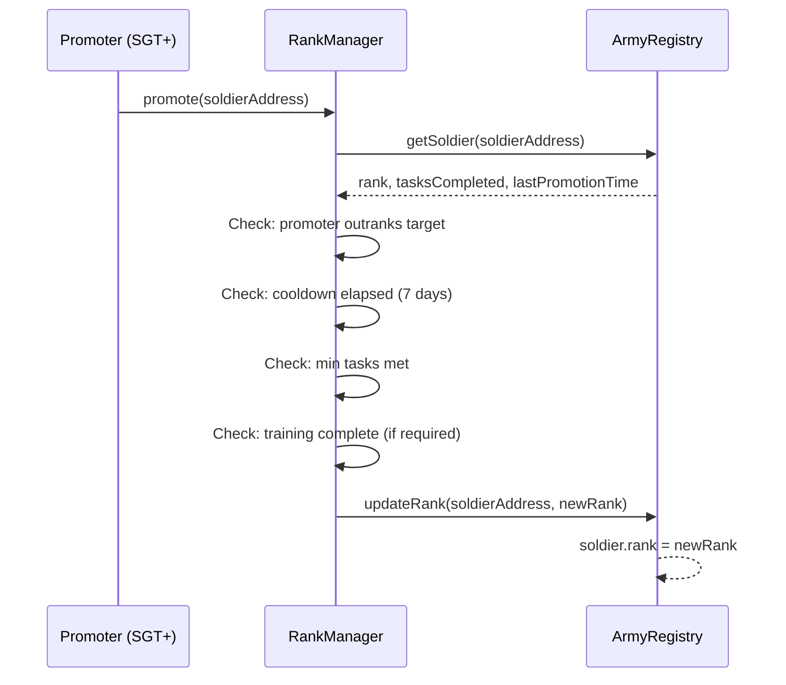

# Promotion Mechanics

This page details the technical process of promoting a soldier, including who can initiate it, what the contract checks, and how to execute it.

## How Promotion Works

Promotion is a two-party action:

1. **The promoter** (a higher-ranked soldier) initiates the promotion
2. **The RankManager contract** validates all requirements and updates the soldier's rank in ArmyRegistry



## Executing a Promotion

=== "BaseScan"

    1. Go to [RankManager on BaseScan](https://base-sepolia.blockscout.com/address/0xcbB1fB5E862D7e339619B55fE2E58dA6f35bc0f2#writeContract)
    2. Connect your wallet (must be SGT+ rank)
    3. Find the `promote` function
    4. Enter the soldier's wallet address
    5. Click "Write" and confirm in MetaMask

=== "Hardhat Console"

    ```javascript
    const rankManager = await ethers.getContractAt(
      "RankManager",
      "0xcbB1fB5E862D7e339619B55fE2E58dA6f35bc0f2"
    );

    const tx = await rankManager.promote("0xSOLDIER_ADDRESS");
    await tx.wait();
    console.log("Promotion successful!");
    ```

## Validation Checks

The RankManager runs the following checks in order. If any check fails, the entire transaction reverts.

### Check 1: Promoter Authority

The promoter must hold a rank higher than the target soldier's current rank. A SGT can promote a CPL, but a SGT cannot promote another SGT.

**Error if failed:** `"Insufficient rank to promote"`

### Check 2: Cooldown Period

At least 7 days (604,800 seconds) must have passed since the soldier's last promotion. This prevents rapid rank inflation.

**Error if failed:** `"Promotion cooldown not elapsed"`

### Check 3: Task Completion Minimum

The soldier must have completed the minimum number of tasks required for their next rank.

**Error if failed:** `"Insufficient tasks completed"`

### Check 4: Training Qualification

For promotions that require training (CPL->SGT requires PLDC, 1SG->2LT and 2LT->1LT require OBC), the soldier's training must be marked as complete.

**Error if failed:** `"Required training not completed"`

## After Promotion

When a promotion succeeds:

1. **Rank is updated** in ArmyRegistry — immediately effective
2. **Reward multiplier changes** — the soldier's next task reward uses the new multiplier
3. **Voting power changes** — the soldier's governance votes now carry the new rank weight
4. **New capabilities unlocked** — if the soldier crossed a tier boundary (Enlisted->NCO or NCO->Officer), they gain access to new protocol functions
5. **Cooldown resets** — the 7-day cooldown starts from the promotion block timestamp

## Self-Promotion

Soldiers cannot promote themselves. The `promote()` function checks that `msg.sender` (the caller) is a different address from the target soldier.

This ensures that promotions involve at least one other person's judgment. Even if a soldier meets all the technical requirements, someone of higher rank must vouch for them by initiating the promotion.

!!! note "Exception: Enlistment"
    The initial "promotion" from GUEST to PVT happens automatically during enlistment and does not require a promoter. This is the only rank transition that is self-initiated.

## Bulk Promotions

The current contract does not support batch promotions. Each soldier must be promoted individually in a separate transaction. For leaders managing large squads, this means one transaction per promotion.

!!! warning "Future Feature"
    **Batch promotion** functionality may be added through a governance proposal or contract upgrade to reduce the operational burden on leaders managing multiple soldiers.
