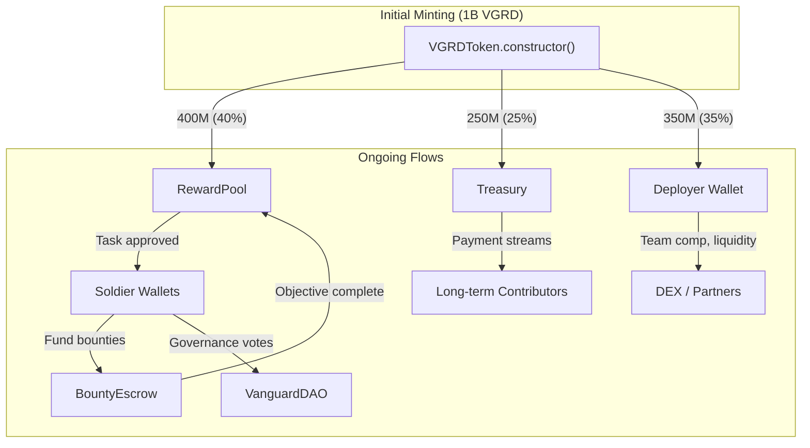

# Supply and Distribution

## Fixed Supply

The total supply of VGRD is **1,000,000,000** (one billion) tokens, all minted at deployment. There is no inflation schedule, no vesting unlock, and no time-based emission.

!!! note "Minting Exception"
    The RewardPool contract holds `MINTER_ROLE` and can mint additional VGRD to fund task rewards if the pool is depleted. Any minting beyond the initial supply is an inflationary event that dilutes existing holders. The decision to enable or constrain additional minting would be made through governance.

## Initial Distribution

At deployment, the 1 billion VGRD tokens were distributed as follows:

| Allocation | Amount | Percentage | Recipient | Purpose |
|------------|--------|------------|-----------|---------|
| **Reward Pool** | 400,000,000 | 40% | RewardPool contract | Task rewards, leader bonuses |
| **Treasury** | 250,000,000 | 25% | Treasury contract | DAO reserve, payment streams, strategic initiatives |
| **Team / Founders** | 350,000,000 | 35% | Deployer wallet | Team compensation, liquidity provision, partnerships |
| **Total** | **1,000,000,000** | **100%** | | |

### Reward Pool (40%)

The largest allocation funds the core incentive mechanism: paying soldiers for completed tasks. The RewardPool contract holds these tokens and distributes them automatically when tasks are approved.

**Key characteristics:**

- Tokens are distributed only upon verified task completion
- Distribution rate is determined by: number of tasks created, base reward amounts set by leaders, and the rank distribution of active soldiers
- Higher-ranked soldiers draw more from the pool per task (due to multipliers)
- The pool is a finite resource — its longevity depends on the rate of task creation and the rank distribution of contributors

### Treasury (25%)

The Treasury holds the DAO's strategic reserve. These tokens are controlled by the `DAO_ROLE` and can be used for:

- Payment streams to long-term contributors
- Strategic partnerships and integrations
- Liquidity provision on decentralized exchanges
- Emergency funding
- Any purpose approved through governance

### Team / Founders (35%)

The deployer wallet retains 350M VGRD for:

- Founding team compensation
- Initial liquidity provision
- Advisor allocations
- Marketing and growth initiatives

!!! warning "Future Feature"
    **Vesting schedules** for the team allocation are not currently enforced on-chain. Implementing a vesting contract or Treasury payment streams for team tokens is a planned governance milestone. Until then, the team allocation is liquid and held by the deployer wallet.

## Token Flow Diagram



## Circulating Supply Analysis

At any point in time, the circulating supply (tokens actively held by individuals rather than locked in contracts) can be estimated as:

```
Circulating Supply = Total Supply
                   - RewardPool Balance
                   - Treasury Balance
                   - BountyEscrow Balance (locked in active bounties)
```

At deployment:

- **Circulating:** 350,000,000 VGRD (35%) — held by deployer
- **Locked in contracts:** 650,000,000 VGRD (65%)

As the protocol operates, tokens flow from contracts to soldier wallets, increasing circulating supply. The rate of this flow is the primary monetary policy lever of the protocol.
